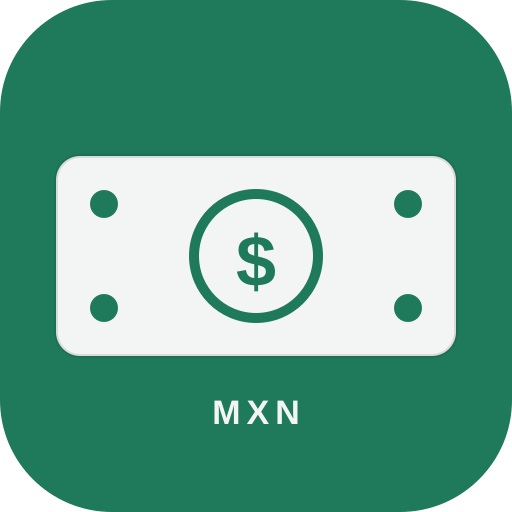

# Control de Finanzas



App móvil para llevar el control de tus finanzas personales: efectivo, débito y crédito, en español y en pesos mexicanos (MXN).

## Funciones

### Cuentas

- Cuentas de efectivo, débito y crédito.
- Nombre, saldo o deuda actual, y para crédito: límite (obligatorio al crear o editar la tarjeta, para que "Confirma tus saldos" pueda pedir el crédito disponible), día de corte, día de pago y frecuencia de pago mensual o quincenal (cada fecha se repite 15 días después). La ayuda debajo de la frecuencia cambia según la opción elegida (Mensual o Quincenal).
- Al guardar una cuenta aparece el aviso "Guardado".
- Barra de uso del límite de crédito y crédito disponible.
- Crear, editar y eliminar cuentas (eliminar una cuenta también elimina sus movimientos).
- Resumen de dinero disponible y deuda total en tarjetas.

### Movimientos

- Registrar ingresos, gastos y transferencias entre cuentas.
- Categorías: Comida, Transporte, Casa, Servicios, Educación, Salud, Ocio, Compras, Sueldo y Otros, más categorías propias que puedes crear y eliminar.
- Nota, fecha y hora (formato 24 h) y monto con formato de moneda. Al crear un movimiento la hora se prellena con la hora actual y se puede cambiar; al editarlo se muestra su hora guardada. La hora se muestra en la lista junto a la fecha ("· 15:30"); los movimientos viejos sin hora se muestran igual que antes.
- Los movimientos se ordenan por fecha descendente y, dentro del mismo día, por hora descendente (el más reciente arriba); los movimientos sin hora van después de los que tienen hora ese día.
- Editar y eliminar movimientos.
- Cada movimiento muestra un ícono de lápiz (✎) para que se vea que se puede editar.
- Buscador por nota, categoría o cuenta, y filtros por tipo (Todos, Ingresos, Gastos, Transferencias).
- Al guardar un movimiento aparece el aviso "Guardado".
- Al crear una compra a MSI en tarjeta de crédito, el formulario muestra la mensualidad en vivo antes de guardar ("Mensualidad: $1,000.00 al mes · 12 pagos").
- Lista de movimientos agrupada por mes, con ingresos y gastos del mes; dentro de cada mes, un pequeño separador por día ("11 de Noviembre 2026") antes de los movimientos de ese día.
- Atajos: botones para tus gastos o ingresos de siempre (por ejemplo, "Pasaje camión"), con monto, cuenta y categoría predefinidos; también se pueden editar y eliminar.

### Tarjetas de crédito y meses sin intereses (MSI)

- Compras a meses sin intereses: pago único o a 3, 6, 9, 12, 18, 24 meses, o un número personalizado.
- Cada compra MSI muestra su mensualidad y cuántos pagos lleva y le faltan.
- Pagar tarjeta: registra el pago desde efectivo o débito, o sin descontar de otra cuenta; el monto no puede ser mayor a la deuda. El formulario muestra la deuda total y, si hay MSI activos, la mensualidad de este mes, con un botón "Pagar solo la mensualidad" para no pagar la deuda completa por accidente.
- Al guardar un pago aparece el aviso "Pago registrado".
- Los pagos se descuentan de los planes MSI, del más viejo al más nuevo; un plan pagado por completo deja de aparecer como activo.

### Gráficas

- En la pestaña **Resumen**, sección **Gráficas** (sin librerías externas, funciona sin internet), con dos selectores que se guardan: uno de **periodo** (Día / Semana / Mes) y uno para escoger cuál gráfica ver — solo se muestra la elegida:
  - **Periodo:** Día = hoy, Semana = semana actual de lunes a domingo, Mes = mes actual. Las tres gráficas respetan el periodo elegido.
  - **Por categoría:** barras con monto en MXN y porcentaje del gasto total del periodo, de mayor a menor.
  - **Ingresos vs gastos (pastel):** gráfica de pastel (donut) de ingresos vs gastos del periodo, con montos, porcentajes y el balance del periodo en el centro.
  - **Evolución:** barras agrupadas de ingresos vs gastos; en Día una sola pareja de barras del día, en Semana una por día (lunes a domingo) y en Mes una por mes de los últimos 6 meses. Al tocar cada barra se ve el monto exacto.
- Los porcentajes siempre suman 100% (se reparte el resto del redondeo entre las categorías con mayor fracción).
- Las transferencias no cuentan como ingreso ni gasto; una compra a MSI cuenta como gasto completo en el mes de la compra, igual que en el resumen.
- Si no hay movimientos en el periodo, muestra "Aún no hay movimientos en este periodo".

### Navegación

- La barra de navegación está fija en la parte de **arriba**, con Resumen, Movimientos, Calendario, Cuentas y el engranaje de Configuración.
- En Configuración puedes elegir el **color de la barra de navegación** (cuarto color del tema), distinto al fondo para que no se pierda; el texto se adapta (blanco u oscuro) según el color que elijas.
- El botón de **regresar** del celular cierra primero el modal que tengas abierto; solo si no hay ningún modal abierto sale de la app.

### Pagos próximos

- Crear pagos pendientes con nombre, monto opcional, fecha y cuenta.
- El botón **+** (abajo a la derecha) te deja elegir entre "Nuevo movimiento" y "Nuevo pago próximo"; también se puede crear un pago próximo desde **Calendario**, con el botón "+ Pago próximo" (usa el día seleccionado, o el de hoy).
- El botón para pagar un pago próximo dice "Revisar y pagar", porque primero se revisa el movimiento y luego se confirma con Guardar.
- Se repiten una vez, cada semana, cada quincena, cada mes o con una frecuencia personalizada (cada N días, por ejemplo cada 10 días); al pagarlos se registra el movimiento y la fecha avanza según la frecuencia elegida. La quincena avanza 15 días, igual que en las tarjetas de crédito.
- El botón de calendario (icono) en cada pago próximo crea el evento en Google Calendar con la repetición correspondiente (semanal, cada 15 días, mensual o cada N días).
- En el Resumen se muestran ordenados por fecha, con avisos cuando faltan 3 días o menos.

### Widget de inicio (5x2)

- Widget de pantalla principal de 5x2 con 5 pestañas solo con iconos (sin textos): **Saldo** (cartera), **Próximos pagos** (calendario), **Ingreso** (flecha entrando), **Gasto** (flecha saliendo) y **Transferencia** (flechas de intercambio).
- **Saldo:** el recuadro de saldo de la app (dinero disponible, deuda en tarjetas, ingresos y gastos del mes).
- **Próximos pagos:** los próximos pagos con fecha y monto, cada uno en su propio recuadro; al picar uno se abre su "Revisar y pagar". El nombre y el monto van en la primera línea y el vencimiento ("vence hoy", "vencido hace 1 día"...) en una segunda línea más chica, para que nada se corte.
- **Tema:** el widget sigue los colores de la app (fondo, principal, modo Claro/Oscuro/Automático); en modo oscuro usa superficies oscuras. En Android anterior a 12 mantiene sus colores fijos.
- **Ingreso, Gasto y Transferencia:** botón "Registrar movimiento" y los atajos de ese tipo (por ejemplo, "Pasaje camión" con "$7.00" en su segunda línea, en Gasto). Al picar un atajo se abre la app con el formulario de movimiento prellenado con ese atajo, y ahí se confirma el registro. El widget **no registra nada en segundo plano**: el toque siempre abre la app.
- El widget muestra máximo 2 pagos próximos y 3 atajos por pestaña; el resto se ve en la app. Si aún no hay atajos de un tipo, la pestaña ofrece crear uno. El contenido se desliza arriba/abajo (la fila de pestañas queda fija y debajo va una lista con el botón, los atajos y los pagos), así nada queda cortado: lo que no quepa se alcanza deslizando. Elementos grandes y legibles (saldo grande, botón de registro de 46dp, filas de pagos de al menos 64dp de alto con el vencimiento en segunda línea, atajos en filas de 2 chips con el monto en su segunda línea y más espacio entre líneas para que el texto no se empalme, textos de 13–16sp). El detalle del saldo se muestra en dos líneas (Deuda y Mes).
- **Cómo funciona:** el widget nativo no puede leer el almacenamiento local de la app, así que la app escribe un resumen (saldos, atajos por tipo, próximos pagos y el tema: colores y modo) en `@capacitor/preferences` cada vez que guarda y al arrancar. El widget lo lee y se actualiza al tocar una pestaña y cada 30 minutos. Al picar un elemento del widget, el toque va primero al provider (broadcast): este guarda el enlace como acción pendiente en el mismo almacenamiento y abre la app con el deep link; la app lo lee al arrancar (además del deep link y del evento `appUrlOpen`), así el formulario siempre se abre aunque Capacitor no entregue la URL del intent. La plantilla de ese toque es un PendingIntent **mutable**: con inmutable, Android ignora el fill-in intent que lleva el enlace y el botón no hacía nada (ni siquiera abría la app); si alguna vez llega sin enlace, el provider abre la app en inicio en vez de quedarse en silencio. El código nativo vive en la carpeta `widget/` y se instala en el proyecto Android con `python3 widget/scripts/install-widget.py` (paso del workflow, después de `npx cap sync`).
- **Para agregar el widget:** instala el APK, mantén presionada la pantalla principal, elige Widgets, busca "Control de Finanzas" y arrástralo. Si el widget pide abrir la app, es porque aún no se han guardado datos desde que se instaló.

### Calendario

- Calendario mensual con navegación por mes y selección de día.
- Marcas por día: pago límite de tarjeta, fecha de corte, pago próximo y movimientos del día.
- Detalle del día seleccionado con sus eventos y movimientos, ingresos y gastos de ese día.
- Botón de calendario (icono) en pagos de tarjeta y pagos próximos: abre el evento en Google Calendar, con repetición mensual cuando aplica.

### Recordatorio diario de saldos

- En la pestaña **Configuración**, sección **Notificaciones**, eliges a qué hora quieres el recordatorio (por defecto, 23:00) y si está activado. Solo funciona si el interruptor maestro de **Notificaciones** está activado.
- Cada día, a esa hora, la app te pide confirmar el saldo de cada cuenta: efectivo y débito por su saldo actual, y las tarjetas de crédito por su **crédito disponible** (deuda = límite − disponible), con los montos que marca la app ya escritos. Si una tarjeta no tiene límite guardado, o su deuda supera el límite, se pide su deuda actual (el disponible no puede representar una deuda mayor al límite). Un disponible mayor que el límite se toma como deuda $0.
- Si corriges un saldo, se crea un movimiento de **Ajuste de saldo** (ingreso, gasto o pago de tarjeta, según el caso) para que la app quede acorde a lo que realmente tienes.
- El recordatorio aparece una sola vez al día. En **Configuración** hay un botón **Probar recordatorio** para verlo en ese momento.
- También muestra la fecha de tu última confirmación de saldos.
- Al tocar la notificación del recordatorio se abre directamente el modal **Confirma tus saldos** para confirmar los saldos en ese momento.

### Recordatorio de pagos próximos

- En la pestaña **Configuración**, sección **Notificaciones**, hay un bloque **Recordatorio de pagos próximos**, igual que la de saldos: interruptor Activado/Desactivado y hora del aviso (por defecto, 09:00). Nace **desactivado**: cada quien lo activa si lo quiere. Solo funciona si el interruptor maestro de **Notificaciones** está activado.
- Un día antes de cada fecha de pago, la app programa una notificación local en el dispositivo, a la hora elegida. Cubre los **pagos próximos** y los **pagos límite de las tarjetas de crédito con deuda**.
- Solo se avisa de fechas que aún no llegan (vence mañana o después). Si un pago vence hoy o ya venció, no hay "día antes" que avisar para esa fecha; si la hora del aviso de hoy ya pasó, ese pago no se programa (la lista de pagos lo sigue mostrando como "vence mañana").
- Las notificaciones se reprograman solas: al abrir la app, al guardar cambios (crear, pagar o editar un pago, pagar una tarjeta, cambiar una cuenta) y al cambiar la hora o el interruptor en Configuración. Al desactivarlo se cancelan los avisos programados. Cada aviso se programa una sola vez (no se repite) y los avisos viejos se cancelan antes de reprogramar, para no duplicar.
- Al tocar la notificación de un pago, la app se abre directamente en su formulario para pagarlo (el pago próximo o la tarjeta); si el pago ya no existe, se abre el Resumen. El recordatorio diario de saldos sigue abriendo **Confirma tus saldos** como antes.
- **En el navegador (sin notificaciones locales):** si un pago vence hoy o mañana y el recordatorio está activado, el Resumen muestra un aviso discreto con el pago y su fecha, sin bloquear nada.

### Notificaciones

- La pestaña **Configuración** se divide en tres secciones: **Notificaciones**, **Apariencia** y **Datos**.
- **Notificaciones** tiene un interruptor maestro **Notificaciones** (Activado/Desactivado) que controla todos los recordatorios. Nace **apagado** para las instalaciones nuevas, para que cada quien lo active y le dé permisos a la app; si ya tenías activado el recordatorio de saldos o el de pagos, al actualizar el maestro arranca prendido para no apagar tus avisos.
- Al activar el maestro se pide el permiso de notificaciones (del sistema en la app, del navegador en web). Si se concede, se reprograman los recordatorios según sus interruptores individuales; si se deniega, el maestro queda apagado y la app avisa que hacen falta los permisos.
- Al desactivar el maestro se cancelan TODAS las notificaciones programadas (saldos y pagos) y los recordatorios quedan inactivos: no llega notificación, no aparece el modal de las 23:00 en la app ni el aviso de pagos en el Resumen. Los interruptores individuales y sus horas se conservan al apagar y prender el maestro.
- Con el maestro desactivado, los dos bloques de recordatorio se ven oscuros (apagados) y no se pueden tocar, con una notita de "Activa las notificaciones para usar los recordatorios". Con el maestro activado se ven normales y cada recordatorio se puede activar o desactivar por separado con su hora.
- **En el navegador:** si el navegador lo permite y la app está abierta, el recordatorio diario llega también como notificación a la hora configurada.
- **En el dispositivo (APK):** con Capacitor y el plugin LocalNotifications, el recordatorio diario se programa en el dispositivo a la hora configurada, para que funcione aunque la app esté cerrada. El recordatorio de pagos próximos también se programa en el dispositivo (un día antes, a la hora elegida), con el mismo mecanismo.
- **Al tocar la notificación:** se abre el modal **Confirma tus saldos** de la app. En el APK funciona incluso si la app estaba cerrada: el toque la abre directamente en ese modal. En el navegador, el toque enfoca la app y abre el mismo modal.
- Si no hay notificaciones disponibles, el aviso aparece dentro de la app al abrirla; Configuración lo dice claramente.

### Configuración y tema

- Pestaña **Configuración** en tres secciones: **Notificaciones** (interruptor maestro, recordatorio diario de saldos con su hora e interruptor y botón **Probar recordatorio**, y recordatorio de pagos próximos con su interruptor —desactivado por defecto— y su hora —por defecto, 09:00—), **Apariencia** (modo y colores) y **Datos** (nota de datos locales y Respaldo). Al apagar el maestro se cancelan también las notificaciones programadas en el dispositivo.
- **Tema / colores:** elige tus propios tres colores para crear tu tema: color principal, color secundario y color de fondo, más el color de la barra de navegación, con un botón para restablecer los colores de siempre. Se aplica en vivo y se guarda en el dispositivo.
- **Modo Claro / Oscuro / Automático:** temas predefinidos de modo claro y oscuro, o automático según el dispositivo. En modo oscuro se conservan las superficies oscuras para que se siga leyendo bien, con tus colores principal y secundario encima.

### Respaldo y datos

- En la pestaña **Configuración**, sección **Respaldo**: **Ver, copiar o descargar respaldo** abre el texto completo del respaldo, que se puede copiar; **en la app** el botón **Compartir respaldo** lo manda al menú de compartir de Android (Drive, Archivos, Keep, etc.) porque el WebView no descarga archivos, y **en el navegador** el botón **Descargar archivo** lo descarga como `respaldo-finanzas.json`; y **Restaurar respaldo** te deja pegar un respaldo para recuperar tus datos; reemplaza los datos actuales. Si el respaldo pegado no es válido, la app avisa y no cambia nada.
- Los datos se guardan solo en este dispositivo, en el almacenamiento local del navegador (`localStorage`, clave `misfinanzas_v1`), y no se sincronizan con otros dispositivos ni con servidores.

## Cómo usarla

### En el navegador

Abre el archivo `index.html` en tu navegador. No necesita servidor ni instalación.

### Como app Android (APK)

Requisitos: Node.js y Android Studio.

```bash
npm install
npx cap add android
npx cap sync
```

Luego abre el proyecto en Android Studio (`npx cap open android`) y genera el APK desde ahí, o compila con Gradle. La app usa el mismo `index.html` y sus datos quedan guardados en el dispositivo.

También se puede automatizar la compilación con GitHub Actions: el workflow `.github/workflows/build-apk.yml` ya está en el repositorio y se ejecuta en cada push a `main` (o manualmente desde la pestaña Actions con "Run workflow"). Instala las dependencias, sincroniza Capacitor y compila el APK de depuración, que queda como artefacto **Control-Finanzas-APK** para descargar. Con ese APK instalado, el recordatorio diario llega con la app cerrada y al tocar la notificación se abre el modal para confirmar saldos.
