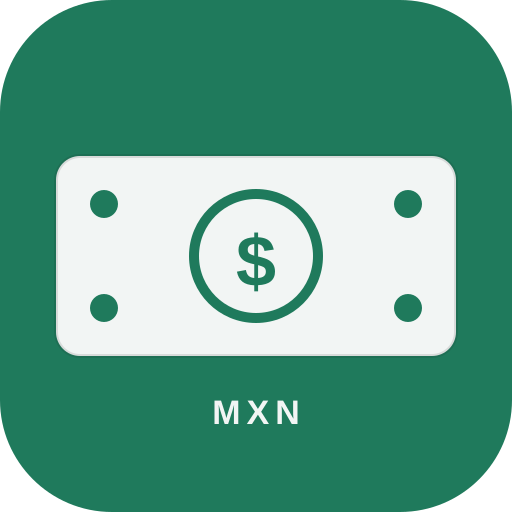
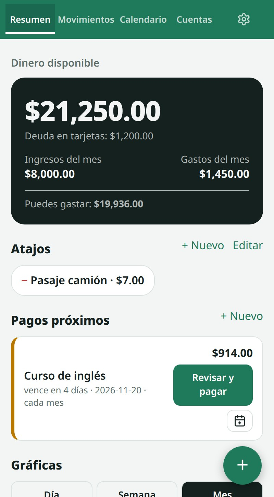
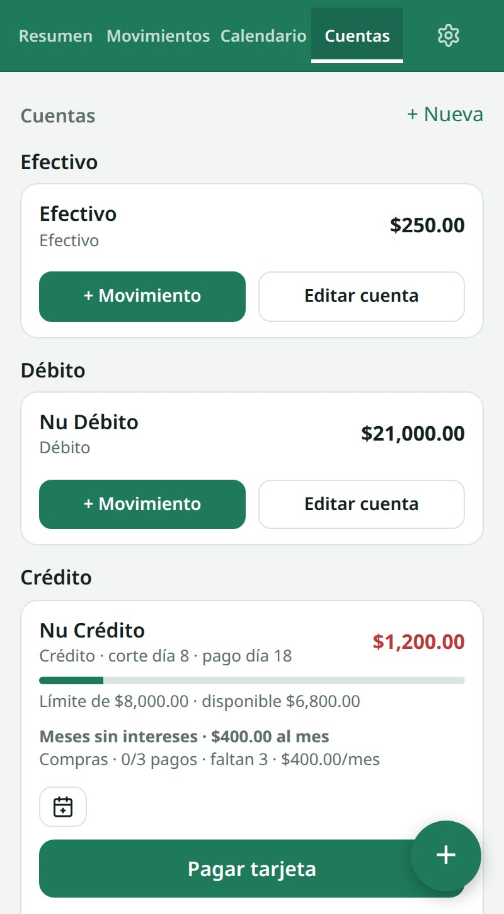
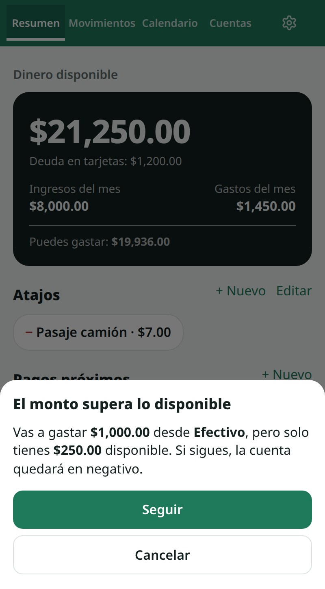
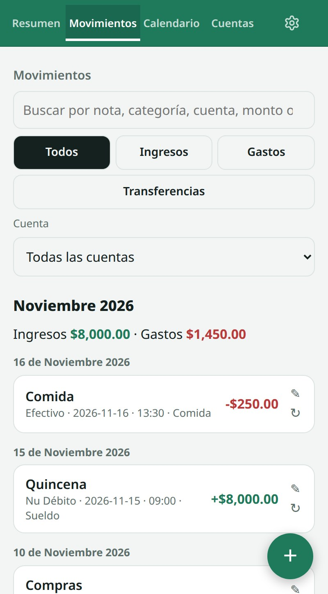
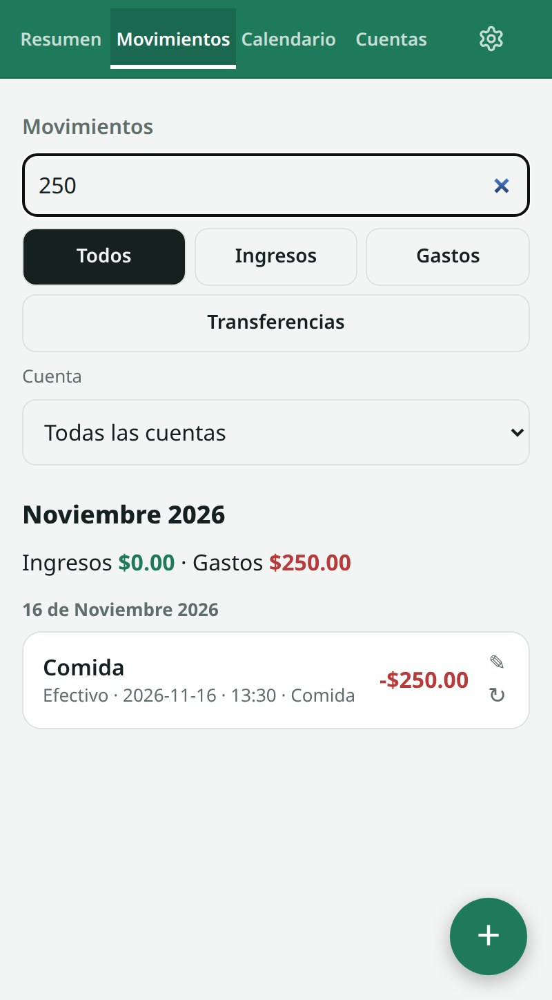
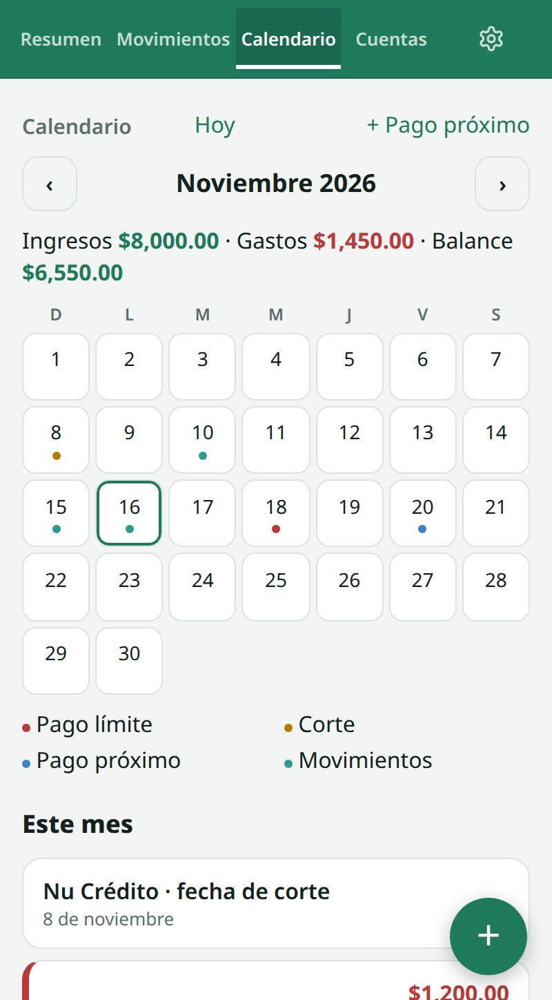
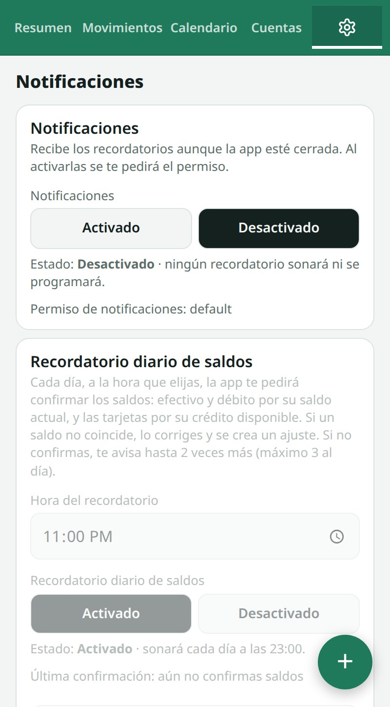
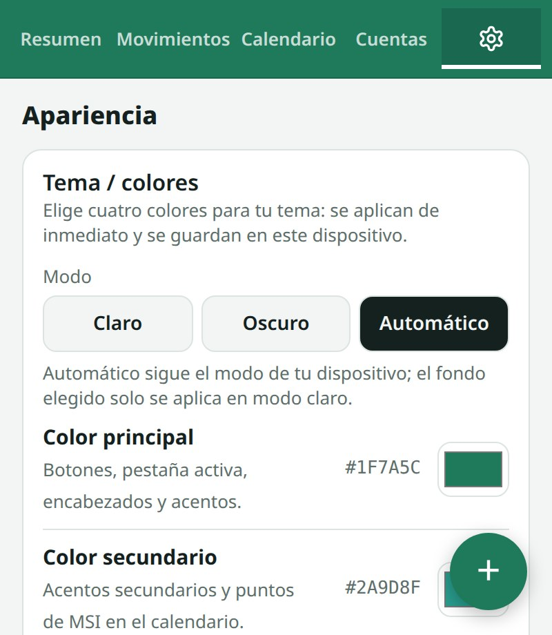
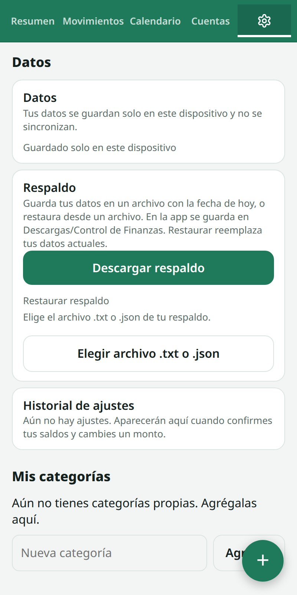

# Control de Finanzas

App para llevar el control de tu dinero: efectivo, débito y crédito, en español y en pesos mexicanos (MXN).

Tus datos se guardan **solo en tu teléfono**; nada se sube a internet ni se comparte con otros dispositivos.

## Capturas de pantalla

## Resumen

- **Dinero disponible**, deuda en tarjetas, ingresos y gastos del mes.
- **Puedes gastar:** lo que te queda de verdad después de restar los pagos próximos que vencen este mes y la mensualidad de tus compras a meses.
- **Atajos:** botones para tus gastos o ingresos de siempre (por ejemplo, "Pasaje camión").
- **Pagos próximos:** tus pagos pendientes ordenados por fecha, con aviso cuando faltan 3 días o menos.
- **Gráficas:** Por categoría, Ingresos vs gastos y Evolución, por día, semana o mes.
- **Compartir reporte del mes:** arma un texto con ingresos, gastos, balance, gastos por categoría y pagos próximos, listo para enviar por WhatsApp.
- **Pagos de tarjeta:** lo que debes pagar este mes en cada tarjeta.

## Movimientos

- Registra **ingresos, gastos y transferencias** entre tus cuentas, con nota, fecha y hora, y categoría. Puedes crear tus propias categorías en Configuración > Mis categorías.
- Al elegir una cuenta, la lista muestra su nombre y su saldo disponible en una segunda línea (en tarjetas: el crédito disponible).
- **Color por cuenta:** si eliges un color para una cuenta (en **Editar cuenta**, tocando el botón de color se abre una mini ventana con el espectro, la cuadrícula de colores y el código hexadecimal), su tarjeta y todos sus movimientos muestran una barrita de ese color a la izquierda, para identificarlos de un vistazo. Sin color, no se muestra nada.
- El campo **Monto** tiene una calculadora: haz la cuenta y toca **Insertar**.
- **Foto del ticket:** tómale foto al ticket o elígela de la galería; se guarda con el movimiento y la puedes descargar.
- Busca por nota, categoría, cuenta, monto o fecha (por ejemplo "500" o "13/11") y filtra por tipo (Todos, Ingresos, Gastos, Transferencias) o por cuenta.
- El lápiz (✎) edita el movimiento y el ícono **↻** de abajo lo repite: abre el formulario ya lleno con los mismos datos y la fecha de hoy.
- Si un gasto supera lo disponible en la cuenta, la app te avisa y tú decides si seguir o cancelar.
- Si al editar una cuenta cambias su **saldo actual**, la app te avisa y crea un movimiento de ajuste para que el saldo quede exacto (y queda registrado en el historial de ajustes).
- Al eliminar un movimiento (o un pago, cuenta, atajo o categoría), la app pregunta antes para que no se borre por accidente.

## Tarjetas de crédito y meses sin intereses (MSI)

- Compra a meses sin intereses: 3, 6, 9, 12, 18, 24 meses o un número propio. Cada plan muestra su mensualidad y cuántos pagos lleva.
- En tarjetas **quincenales** los planes son en quincenas: 3, 6, 9, 12 quincenas o un número propio, y el pago se calcula por quincena.
- El selector de plazos usa el mismo estilo que el de cuentas, con animación al abrir y cerrar.
- **Pagar tarjeta:** paga desde efectivo o débito, o sin descontar de otra cuenta. Si hay MSI activos, puedes pagar solo la mensualidad (o solo la quincena, en tarjetas quincenales). Los pagos se aplican primero a los planes MSI más viejos.

## Calendario

- Ve el mes con marcas por día: pago límite, corte, pago próximo y movimientos.
- Debajo del mes ves los totales de ese mes (ingresos, gastos y balance).
- Toca un día para ver sus eventos y movimientos, y crea un pago próximo desde ese día.
- Puedes agregar los pagos a Google Calendar.

## Pagos próximos

- Crea pagos pendientes con nombre, monto, fecha y cuenta.
- Se repiten una vez, cada semana, cada quincena, cada mes o cada N días.
- Puedes ponerles un fin: que se repitan hasta X veces o hasta una fecha; al llegar al fin quedan como **Finalizado** (no se borran).
- Para pagar, toca **Revisar y pagar**.

## Recordatorios

En **Configuración > Notificaciones** está el interruptor maestro: si está apagado, ningún recordatorio suena.

- **Recordatorio diario de saldos:** cada día a la hora que elijas (por defecto 23:00), la app te pide confirmar el saldo de cada cuenta. Las tarjetas se confirman por su **crédito disponible**. Si corriges un saldo, se crea un ajuste para que todo cuadre. Si no confirmas, te avisa hasta 2 veces más (máximo 3 avisos al día). Hay un botón **Probar recordatorio**.
- **Recordatorio de pagos próximos:** te avisa un día antes y el mismo día de cada pago (por defecto a las 09:00). Nace apagado: actívalo si lo quieres. Al tocar el aviso se abre el formulario para pagar.

## Recordatorio por ubicación (solo en la app)

Si activas **Recordatorio por ubicación** en Configuración > Ubicación, la app te avisa al salir de un comercio registrado para que registres el gasto. Funciona aunque la app esté cerrada.

- Al activarlo te pedirá el permiso de ubicación. Para que el aviso llegue con la app cerrada también hace falta el permiso de ubicación en segundo plano ("Permitir todo el tiempo"): si falta, la misma sección te explica y te lleva a los ajustes del sistema.
- Toca **Ver comercios** para ver tus comercios registrados, agregar nuevos, editarlos, desactivarlos o eliminarlos. Cada comercio se puede activar o desactivar por separado.
- Para agregar un comercio: toca **Agregar comercio**, escribe el nombre y el radio en metros, y elige la ubicación moviendo el pin en el mapa o tocando **Usar mi ubicación actual**. No hace falta estar en el lugar ni escribir direcciones.
- Al salir de un comercio activo (después de haber estado dentro un rato) llega una notificación; al tocarla se abre el formulario de gasto con el nombre del comercio en la nota.
- Apagar el interruptor general quita todas las geocercas; desactivar un comercio quita solo la suya.

## Configuración: apariencia

- Crea tu propio tema con tus colores (principal, secundario, fondo y barra de navegación) tocando cada color: se abre una mini ventana con el espectro, la cuadrícula y el código hexadecimal; o usa el modo Claro, Oscuro o Automático.

## Respaldo y datos

- En **Configuración > Datos**, **Descargar respaldo** guarda un archivo con la fecha en tu carpeta de Descargas. Para recuperar tus datos, toca **Restaurar respaldo** y elige el archivo.
- **Historial de ajustes:** ahí ves los cambios de saldo que hiciste al confirmar tus saldos (los últimos 2 días, con **Ver más** para ver todos).
- Las fotos de los tickets viajan dentro del respaldo.

## Widget de inicio (5x2)

- Widget para la pantalla principal con 5 pestañas: Saldo, Próximos pagos, Ingreso, Gasto y Transferencia.
- Desde ahí ves tu saldo y tus próximos pagos, y puedes abrir el formulario para registrar un movimiento con tus atajos. El widget nunca registra nada solo: siempre abre la app para que confirmes.
- En la pestaña Saldo ves tu saldo arriba y, abajo en dos columnas, tu deuda en tarjetas y lo que puedes gastar a la izquierda, y los ingresos y gastos del mes a la derecha.
- Puedes cambiar el color de fondo del widget en Configuración > Apariencia; si no lo cambias, sigue los colores de tu tema.
- Para agregarlo: mantén presionada la pantalla principal, elige Widgets, busca "Control de Finanzas" y arrástralo.

## Cómo moverte por la app

- La barra de arriba tiene Resumen, Movimientos, Calendario, Cuentas y Configuración (el engranaje).
- También puedes cambiar de pestaña deslizando el dedo a la izquierda o a la derecha.
- El botón **+** (abajo a la derecha) te deja crear un movimiento o un pago próximo.
- El botón de regresar del teléfono cierra primero la ventana que tengas abierta.

## Instalar y actualizar

- Puedes usarla en el navegador (https://alexloza247.github.io/Control-Finanza/) o instalar el APK en tu teléfono.
- Cada APK nuevo se instala desinstalando el anterior, porque cada versión se firma de forma distinta. **Antes de desinstalar, haz tu respaldo** con Descargar respaldo, porque al desinstalar se borran los datos.
